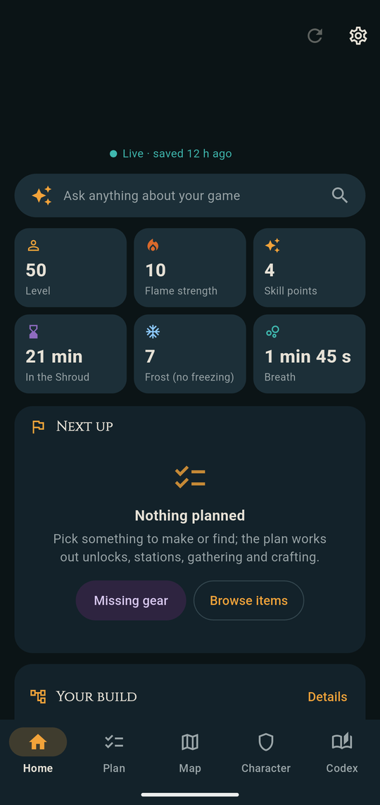
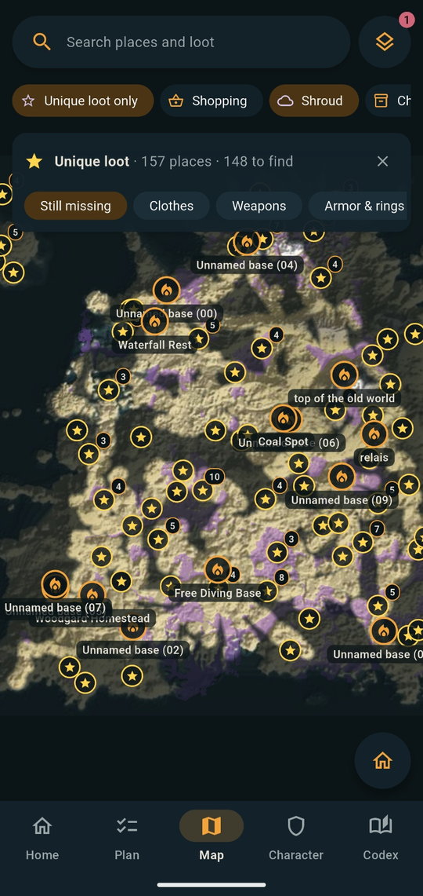
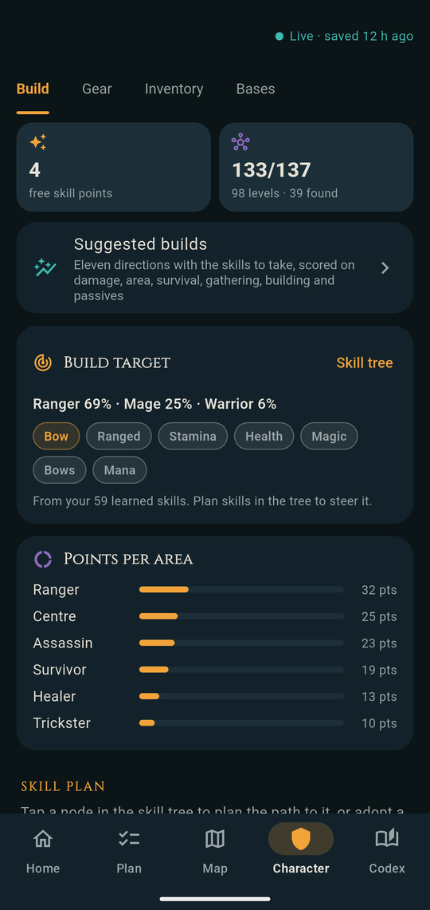
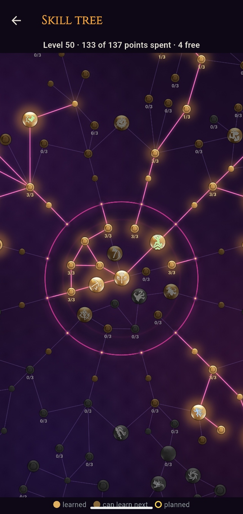
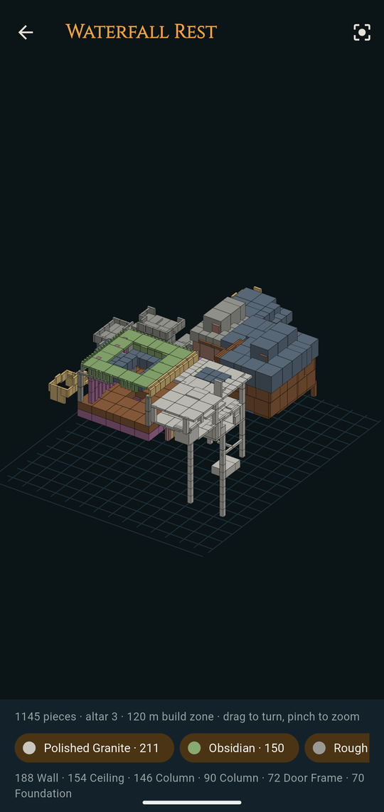
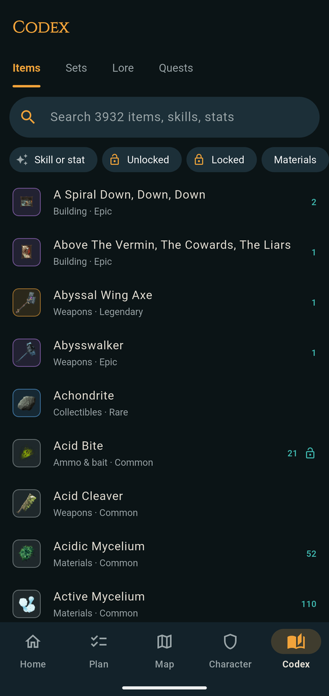

# Enshroud Buddy

A companion for **Enshrouded** on your Android phone, fed by a small agent on your gaming PC. It reads your save
files and shows your game on the phone, while you play or away from the PC:

- **Map** with every place, chest, lore note, fishing spot and Shroud Root, your explored area, Shroud levels
  and cold zones, your bases, and your own pins. With the game running it shows where you are, and the
  **guide** leads you to a place. It tells on foot from gliding, checks whether a glide reaches against the
  terrain, and suggests higher ground to launch from.
- **Unique loot**: search any piece that lies in a chest, or a whole set ("Farmer Set", cosmetics too), and
  the map shows only where it is. "Unique loot only" shows what you're still missing, by kind. Each chest
  says how high it is: under the surface (caves, cellars, the sea floor), on an island, or above or below you.
- **Hollow Halls**: each hall's floor plan (your floor bright when you're inside), what's left to find there
  against what you already have, its quests, and a check before you go: level, gear, damage the Hollow
  resist or fear, grappling hook, healing.
- **Character**: your gear, bag and every chest (search across all of them), bases and stations, build and
  skill tree with gear advice for your level, survival numbers (Shroud time, cold, breath), and your progress
  over time.
- **Plan**: pick what you want to make; it lists what to gather, craft and fetch, and where, nearest first,
  with a farming route. **Hunt nearby** leads you to every lore page, unique piece, Shroud Root, Elixir Well,
  obelisk, shrine or sanctum you're missing, anywhere or in one region, nearest first, moving on
  to the next by itself (the PC runs it, so it carries on with the phone in your pocket).
- **Codex**: every item, recipe, set, lore page and quest from the game's own data; find gear by the skill or
  stat it gives.
- **Ask** (optional): questions about your game answered by Claude, from your save and the game data.

  
  
  
  
  
  

> *Unofficial fan project. Not affiliated with or endorsed by Keen Games. Enshrouded and its content are the property of Keen Games GmbH.*
>
> Free for everyone, under Keen Games' Fan Project Guidelines. See [NOTICE.md](NOTICE.md).

## What you need

- A Windows PC with Enshrouded on Steam.
- An Android phone on the same home network (Wi-Fi) as the PC, or any other phone, tablet or browser there
  (iPhone and iPad included): the PC program serves the app as a web page too.

## Install

Both files are on the **[latest release](../../releases/latest)** page. What changed in each version: [patch notes](CHANGELOG.md).

### On the PC (once)

1. Download **`EnshroudBuddy.exe`** and open it.
2. Windows may say it "protected your PC", because the program isn't signed. Click **More info**, then
   **Run anyway**.
3. If Windows asks whether Enshroud Buddy may use the network, tick **Private networks** and allow it. That's
   how the phone reaches it. (If your home Wi-Fi is set to "Public" in Windows, switch it to Private first:
   Settings → Network → your Wi-Fi → Private network.)
4. A window shows a **QR code**. Keep it open for the phone.

That's all: it starts with Windows from now on, as a small round icon in the tray (bottom right, maybe under
the `^` arrow). To show the QR code again, click that icon. To remove it, right-click it, **Uninstall from this
PC**.

### On the phone

1. Open the release page in the phone's browser and tap **`EnshroudBuddy.apk`**.
2. Open the download. Android asks once to allow installs from your browser: allow it, then **Install**.
3. Open the app, tap the **gear icon** on Home (Setup), then **Scan the PC's code** and point the phone at the
   QR code.
4. In **Game save**, pick your world and character, then **Read this save**. The rest of the app fills in
   within seconds, and again after every game save (about every 30 s while you play).

### On an iPhone, iPad or another browser

1. On the PC, click the tray icon: the pairing window shows a second QR code, "iPhone, iPad or any browser".
2. Scan it with the camera and open the link: the app opens in the browser, already paired. If nothing loads,
   tap **Other address** under that code on the PC and scan again (a PC can have several network addresses).
3. In Safari: Share → **Add to Home Screen**, to open it like an app.

The web app has the same screens as the Android app, without voice and the code scanner. It needs the PC
program running, as that is where it comes from.

### Updates

The app tells you on Home when a new version is out: tap **Update** and install over the old one, nothing is
lost. For the PC, download the new `EnshroudBuddy.exe` and open it: it replaces the old one and starts again.

## Good to know

- **Languages:** the app and the PC program speak the 15 languages Enshrouded ships, following your phone (Setup →
  Language picks another). Game names, lore and quests are Keen's own translations from the game; menus and
  explanations are ours, so corrections from native speakers are welcome.
- **Only your phone gets in.** The agent answers only devices on your home network whose requests are signed
  with its pairing code. The code itself never crosses the network, so others on your Wi-Fi can't pick it up,
  and web pages open in a browser get nothing. The code is made once per PC and kept in `config.json` (in
  `%LOCALAPPDATA%\EnshroudBuddy`, or `agent\` from source). Delete that file to make a new one.

- **The agent only reads.** It copies your save files and reads the copies; it never changes a save or the
  game's files.
- **Live position** (your arrow on the map, the guide, glide measuring) reads the running game's memory,
  read-only, about once a second, and searches it only while the phone shows the map. It never writes to the
  game, injects anything or touches other players. Enshrouded has no anti-cheat today, but Keen's terms of use
  don't allow tools of this kind in general, and a future patch could change things. To leave the game alone,
  untick **Live position** in the tray menu; it stays off, also after updates. Everything else keeps working
  from your saves.
- **Playing in a friend's world:** the world is saved on the host's PC, so your PC only has your character.
  In Setup → Game save, pick **A friend's world** and set the host's Flame strength: you get your gear, bag,
  skills, map and live position, but not their bases and chests.
- **Ask** needs [Claude Code](https://docs.anthropic.com/en/docs/claude-code) installed and signed in on the PC.
  It uses your Claude plan's usage (never an API key, even if one is set on the PC), and reads pages of the
  [Enshrouded wiki](https://enshrouded.wiki.gg) when a question needs them. Without Claude Code, Ask just says
  it isn't available.
- **Privacy:** your saves, position and everything the app shows stay on your home network. What goes online:
  - **Ask:** your question, and what Claude needs from your save to answer it (character, gear, chests, bases,
    where you are), go to Anthropic through Claude Code, under Anthropic's terms and privacy policy.
  - **Voice Ask:** the mic uses your phone's speech recognition (Google's on most phones).
  - **QR pairing:** Google Play services' code scanner reads the code on the phone; Google may collect usage
    metrics for it ([Google's privacy policy](https://policies.google.com/privacy)). Nothing about you or the
    code is sent.
  - **Updates:** once a day the app asks GitHub for the latest release, sending nothing about you.
  - **Web app fonts:** in a browser, the page loads its fonts (Roboto, and Noto for Japanese, Chinese, Korean and
    Thai) from Google Fonts (fonts.gstatic.com), as any web page using them does. The Android app doesn't.
  Nobody else, us included, gets anything: there are no accounts, ads or analytics.

## Troubleshooting

- **"Agent unreachable":** the agent must be running (tray icon) and the phone on the same Wi-Fi as the PC.
  Scan the code again (click the tray icon). Check that Windows Firewall allows Enshroud Buddy (or Python, from
  source) on private networks.
- **Wrong character or world:** Setup → Game save.
- **An amber notice on Home** means the save holds something new to the reader (often after a game patch).
  Most things keep working; a fix comes with the next version.
- The agent writes a log to `agent.log` in `%LOCALAPPDATA%\EnshroudBuddy` (tray menu → Open log folder), or
  `agent\` from source.
- **Windows or an antivirus warns about the exe:** it isn't signed, as signing costs money each year. It is
  built from this repository's code by `tools/build_agent.py`; you can build it yourself if you prefer.

## For developers

- `app/` is the Flutter app (`flutter build apk --release`).
- `agent/agent.py` is the PC agent. From source it needs Python 3.10 or newer: run `agent\install.bat` once,
  then `agent\start.bat`. `python tools/build_agent.py` builds `EnshroudBuddy.exe`.
- `tools/` holds the save reader (`ksd.py`, `state.py`) and the live position (`livepos.py`, `motion.py`,
  `glide.py`).
- `tools/build_db.py` and `tools/build_map.py` turn a game-data export (`tools/eml-export`, run with the
  [EML loader](https://github.com/Brabb3l/kfc-parser)) into the app's assets.
- `tools/release.py` assembles this repository.
